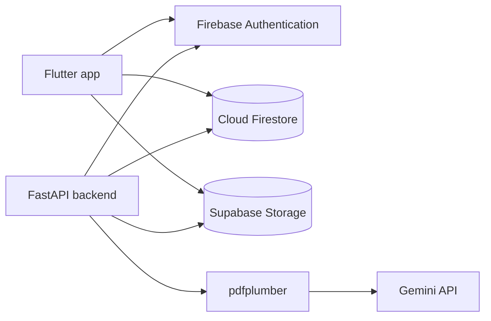

# AI-Powered Resume Screener and Recruitment Management System

A Flutter recruitment app backed by Firebase Authentication and Cloud Firestore, with Supabase Storage for resume PDFs and a Python/FastAPI service for Gemini-based resume profile extraction.

> **Implementation note:** The project currently supports authentication, role-based client routing, job management, resume upload, and job application creation. Backend resume extraction exists but is not yet called by Flutter. Candidate matching/ranking, real admin candidate review, offer generation, approval, and delivery are not implemented.

## Features

- Email/password registration, login, logout, and password reset.
- Candidate/admin dashboard routing using a Firestore user role.
- Admin job creation, editing, closing/reopening, and deletion.
- Candidate job browsing/search and application submission.
- Resume PDF upload/replacement to Supabase Storage, with Firestore metadata.
- Automatic resume text chunking and Gemini vector embedding to Supabase pgvector after upload (requires the SQL migration and API URL configuration).
- FastAPI endpoint for PDF text extraction and Gemini structured profile extraction (not wired into the Flutter UI).
- Static/demo-only candidate review and analytics screens; these are not live recruitment data.

## Technologies

- Flutter / Dart
- Firebase Authentication and Cloud Firestore
- Supabase Storage
- Python / FastAPI / Uvicorn
- `pdfplumber`, Pydantic, Firebase Admin SDK
- Google Gen AI SDK (Gemini)

Firebase options are configured for Android and web in source. Other platform Firebase options are unsupported until configured. See [docs/IMPLEMENTATION_STATUS.md](./docs/IMPLEMENTATION_STATUS.md) for the verified state.

## Architecture



The backend has no current caller in the Flutter application. Read [docs/SYSTEM_ARCHITECTURE.md](./docs/SYSTEM_ARCHITECTURE.md) for data flow and boundaries.

## Folder Structure

```text
lib/                  Flutter app, shared core, auth/user/admin features
backend/app/          FastAPI routes, Pydantic schemas, Gemini service
android/, web/, ...   Flutter platform projects
test/                 Flutter widget tests
docs/                 Architecture, workflows, schema, API, setup, handoff
```

## Setup and Run

### Flutter

Prerequisite: Flutter with Dart compatible with the `^3.11.0` SDK constraint.

```powershell
flutter pub get
flutter devices
flutter run --dart-define=API_BASE_URL=http://10.0.2.2:8000
```

Configure Firebase for the intended platform before running. Android and web have checked-in FlutterFire settings; other platform options need configuration. Set `API_BASE_URL` to a backend address reachable from the selected device (`10.0.2.2` is the Android emulator host alias; use localhost for web and a reachable HTTPS URL for production). Supabase client settings are in `lib/core/supabase/supabase_config.dart`. Never put a server-side Supabase secret in the app.

### FastAPI backend

From PowerShell:

```powershell
Set-Location .\backend
py -m venv .venv
.\.venv\Scripts\Activate.ps1
python -m pip install --upgrade pip
pip install -r requirements.txt
```

Configure local environment variables `SUPABASE_URL`, `SUPABASE_SECRET_KEY`, `FIREBASE_SERVICE_ACCOUNT_PATH`, and `GEMINI_API_KEY`; `GEMINI_MODEL` is optional. Do not commit `.env` or service-account files. `backend/.gitignore` ignores `backend/.env`; see [docs/AUTHENTICATION_AND_SECURITY.md](./docs/AUTHENTICATION_AND_SECURITY.md) for credential handling.

Before running, apply `supabase/migrations/20261105000000_resume_embeddings.sql` to the Supabase project. For Flutter Web, set backend `FRONTEND_ORIGINS` to the exact browser origin.

Run from `backend`:

```powershell
uvicorn app.main:app --reload --host 0.0.0.0
```

Local OpenAPI UI is normally at `http://127.0.0.1:8000/docs`. The API expects Firebase bearer tokens for resume screening. See [docs/SETUP_GUIDE.md](./docs/SETUP_GUIDE.md) for limitations and configuration checks.

## Tests

```powershell
flutter analyze
flutter test
```

The checked-in Flutter test is a starter counter test that does not match the app. Backend unit tests cover text chunking; Firebase, Gemini, and Supabase integration still needs verification.

## Documentation

- [Project overview](./docs/PROJECT_OVERVIEW.md)
- [System architecture](./docs/SYSTEM_ARCHITECTURE.md)
- [Project workflows](./docs/PROJECT_FLOW.md)
- [Database schema](./docs/DATABASE_SCHEMA.md)
- [API documentation](./docs/API_DOCUMENTATION.md)
- [AI workflow](./docs/AI_WORKFLOW.md)
- [Authentication and security](./docs/AUTHENTICATION_AND_SECURITY.md)
- [Implementation status](./docs/IMPLEMENTATION_STATUS.md)
- [Setup guide](./docs/SETUP_GUIDE.md)
- [Development decisions](./docs/DEVELOPMENT_DECISIONS.md)
- [AI developer handoff](./docs/AI_HANDOFF.md)

## Screenshots

Add current, sanitized screenshots here:

| Screen | Screenshot |
|---|---|
| Login / registration | _Screenshot placeholder_ |
| Candidate dashboard | _Screenshot placeholder_ |
| Admin dashboard | _Screenshot placeholder_ |

Do not include personal data, tokens, or credentials in screenshots.

## Future Improvements

1. Define and test Firestore/Supabase least-privilege access policies.
2. Connect Flutter to the resume-screening API and fix backend error mapping.
3. Replace demo candidate/analytics values with real persisted application data.
4. Implement explainable candidate-job matching/ranking.
5. Implement offer generation, admin approval, and delivery only after defining secure workflows.
6. Add automated frontend/backend tests, deployment configuration, and supported-platform Firebase setup.
