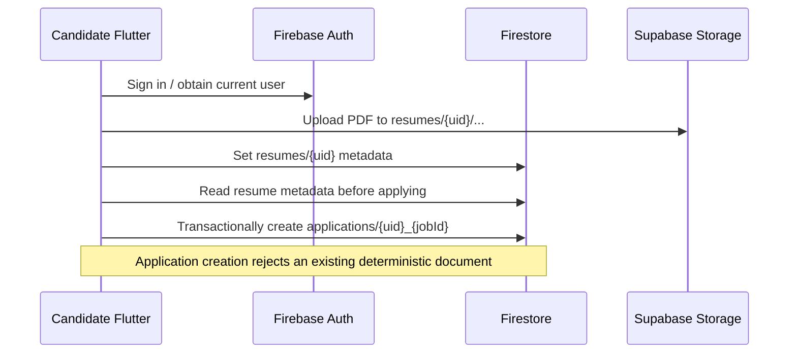

# Project Flows

Status labels describe the current source, not a product roadmap:

- **Implemented:** connected source path exists.
- **Partially implemented:** some UI or service logic exists, but an integration, persistence, or authorization step is missing.
- **Planned / not implemented:** no working source path was found.

## 1. User Registration and Login — Implemented

1. `lib/features/auth/screens/signup_screen.dart` validates a form and calls `AuthService.signup`.
2. `lib/core/services/auth_service.dart` creates an email/password Firebase account, updates its Firebase display name, then writes `users/{uid}` with `uid`, `name`, `email`, `role: "user"`, and `createdAt`.
3. If Firestore profile creation fails, it attempts to delete the newly created Auth user; rollback errors are swallowed, then the original error is rethrown.
4. `login_screen.dart` calls `AuthService.login`; Firebase auth-state changes trigger `AuthWrapper`.
5. Password reset is supported by `AuthService.resetPassword`, surfaced in admin settings.

The login screen currently prints a Firebase ID token to debug output. Remove this before production use.

## 2. Role-Based Authentication — Partially Implemented

1. `AuthWrapper` listens to `FirebaseAuth.instance.authStateChanges()`.
2. Signed-out users see `LoginScreen`.
3. Signed-in users are looked up via `UserService.getUserRole`, which reads `users/{uid}.role`.
4. `admin` routes to `AdminDashboard`; `user` routes to `UserDashboard`; missing/unrecognized role shows an error.

This is client-side routing, not authorization enforcement. No Firestore security rules were found, and backend endpoints do not check the Firestore role. No admin signup/provisioning UI exists; an admin role must be provisioned outside the app. Actual deployed access controls need verification.

## 3. Admin Dashboard — Partially Implemented

`lib/features/admin/screens/admin_dashboard.dart` switches among Overview, Create Job, Manage Jobs, Candidates, Analytics, and Settings. Logout calls `AuthService.logout`.

- Overview reads real Firestore jobs via `AdminService.getJobs`; total jobs and recent postings are live. Candidate/review/shortlist counts are literal zero values.
- Create Job and Manage Jobs are connected to Firestore.
- Candidate records and analytics are local sample data, not connected to Firestore.
- Settings updates Firebase Auth display name and sends a password reset email. Company name and notification choices are local form state only.

## 4. Candidate Dashboard — Partially Implemented

`lib/features/user/screens/user_dashboard.dart` streams jobs, the current user's applications, and the current user's resume through `UserJobService`. It displays active jobs and allows search by title, department, or location. Resume upload and application submission are connected.

Applications are reflected as a count and applied state; there is no complete application-status management or offer workflow. No AI match score is read by this screen.

## 5. Resume Upload and Embedding — Implemented in code (backend deployment required)

1. Candidate chooses a PDF using `file_picker` in `UserDashboard._pickAndUploadResume`.
2. The app checks that file bytes are non-empty and no larger than 5 MiB.
3. `UserJobService.uploadOrReplaceResume` sanitizes the filename and uploads to Supabase bucket `resumes` at `{uid}/{milliseconds}_{safeFileName}`.
4. It writes metadata to `resumes/{uid}` in Firestore.
5. If metadata write fails, it attempts to delete the just-uploaded file. Once metadata is saved, it attempts to delete a previous resume file.
6. `UserDashboard._pickAndUploadResume` calls `ResumeProcessingService.generateResumeEmbeddings()`, which sends the Firebase ID token to `POST /api/resumes/embed`.
7. The backend fetches the current PDF, extracts text, creates overlapping chunks, asks Gemini for document embeddings, and saves them in the Supabase `resume_embeddings` table using pgvector.
8. The backend updates `resumes/{uid}.embeddingStatus`; the upload UI reports the number of indexed chunks or a processing failure.

The UI selects PDF extensions; the frontend does not validate the actual PDF signature. The backend validates the `%PDF-` prefix. Bucket privacy and Storage policies are not in the repository. The Supabase SQL migration must be applied, and Flutter must be run with a reachable `API_BASE_URL`.

## 6. Resume Storage and Embedding Records — Partially Implemented

The upload/download code uses Supabase Storage, Firestore stores metadata/status, and the backend stores chunk vectors in Supabase PostgreSQL. The migration is `supabase/migrations/20261105000000_resume_embeddings.sql`. Deployed migration state, bucket privacy, size/MIME policy, and access policies are **Needs verification**. Firebase Storage is declared as a Flutter dependency but is not used by the inspected application code.

## 7. Resume Information Extraction — Partially Implemented

Backend route `POST /api/resumes/screen` in `backend/app/main.py` performs profile extraction, but Flutter does not invoke it:

1. Verify Firebase ID token and use its UID.
2. Read `resumes/{uid}` from Firestore.
3. Check bucket/path metadata and enforce a UID-prefixed path.
4. Download the file from Supabase, check PDF signature, and extract text using `pdfplumber`.
5. Pass text to `extract_candidate_profile` in `backend/app/services/gemini_service.py`.
6. Save the structured result under `candidate_profiles/{uid}`.

No OCR is used; scanned PDFs without extractable text return an error path. In the upload-triggered embedding endpoint, in-route validation errors preserve their HTTP status.

## 8. Job Creation by Admin — Implemented

`CreateJobScreen.createJob` validates fields and calls `AdminService.createJob`. The service adds a `jobs` document with title, department, location, job type, salary, description, responsibilities, education, experience, comma-separated skills converted to a list, `status: "Active"`, `createdBy`, and server timestamps.

## 9. Resume Embedding on Upload — Implemented in code; runtime configuration required

The upload flow invokes `POST /api/resumes/embed`. It stores one row per chunk, including the text and 768-dimensional vector, in Supabase pgvector. Chunking uses a maximum of 1,800 characters with 200 characters of overlap. `gemini-embedding-001` is the default model; `GEMINI_EMBEDDING_MODEL` can override it, but the database column must continue matching the configured vector dimensions.

This creates vector data for future semantic search but does not itself perform semantic search or candidate-job matching. Apply the SQL migration and configure `API_BASE_URL` before using the flow.

## 10. AI-Based Candidate Screening — Partially Implemented

Gemini profile extraction exists behind the backend screening route. There is no Flutter API call, admin trigger, queue, or automatic post-upload screening. The current backend produces a profile; it does not make a hiring decision.

## 11. Candidate-Job Matching and Ranking — Planned / Not Implemented

`backend/app/schemas/job_matching_schema.py` declares `JobRequirements`, `MatchScores`, and `CandidateMatchResult`. No implementation calculates these scores, no matching endpoint exists, and no ranking is persisted or displayed. Default zero values in a schema are not computed scores.

## 12. Candidate Selection — Partially Implemented Demo Only

`CandidatesScreen` has local hard-coded records and local state transitions to Shortlisted, Rejected, or Pending. It does not read applications or profiles from Firestore, does not persist decisions, and is not connected to matching output. This is not a real candidate selection workflow.

## 13. AI-Generated Personalized Job Offer — Planned / Not Implemented

No offer schema, prompt, service, endpoint, or UI integration was found.

## 14. Admin Review and Approval — Planned / Not Implemented

No generated-offer review/approval workflow exists. The local demo candidate status actions are separate and do not implement offer approval.

## 15. Sending Approved Offers to Candidates — Planned / Not Implemented

No email, notification, offer dispatch endpoint, or candidate offer view was found.

## Application Submission Sequence



## Backend Profile Extraction Sequence (Separate from Upload Embedding)

```mermaid
sequenceDiagram
  participant Caller as Authenticated API caller
  participant API as FastAPI
  participant Firebase as Firebase Auth + Firestore
  participant Supabase as Supabase Storage
  participant PDF as pdfplumber
  participant Gemini as Gemini API
  Caller->>API: POST /api/resumes/screen + Firebase ID token
  API->>Firebase: Verify ID token; read resumes/{uid}
  API->>Supabase: Download UID-owned PDF path
  API->>PDF: Extract text per page
  API->>Gemini: Generate CandidateProfile JSON
  API->>Firebase: Set candidate_profiles/{uid}
  API-->>Caller: Profile and extraction metadata
```

The upload-triggered embedding endpoint is documented separately in [API_DOCUMENTATION.md](./API_DOCUMENTATION.md). It stores chunk vectors but does not produce a candidate profile or perform job matching.
